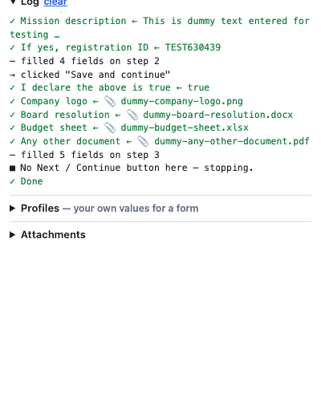

# Form Pilot

A Chrome extension that fills **any web form with realistic dummy data in one click**,
including dropdowns, radios, checkboxes, multi-step wizards and **file uploads**.
It's built for developers and testers who are tired of typing the same test data into
long forms.



## Features

- **Works on any form.** There's nothing to configure: Form Pilot reads each field's
  label, name, type and validation rules and works out a believable value.
- **Smart values.** Company and person names, emails, Indian mobile numbers, PAN, GSTIN,
  CIN, IFSC, PIN codes, addresses, past and future dates, amounts, percentages, and
  engineering quantities such as mass, altitude and inclination.
- **Respects validation.** `maxlength`, `minlength`, `min`/`max`/`step` and `pattern` are
  honoured; a field with `pattern="[A-Z]{5}[0-9]{4}[A-Z]"` gets a value that matches.
- **Every kind of control.** Text, textarea, date/time, number, `<select>`, radio
  groups, checkboxes, `contenteditable`, and custom MUI / Ant Design / react-select
  dropdowns.
- **Dummy file uploads.** Each upload field gets a small, valid generated file of a
  type its `accept` allows: PDF, PNG/JPG/WebP, DOCX, XLSX, CSV, JSON, XML, SVG or ZIP.
  You can also add your own sample files and use those instead.
- **Dynamic forms.** Fields that appear after an answer ("If yes, give details") are
  filled on a follow-up pass, and empty repeatable tables get a first row ("Add a row").
- **Multi-step wizards.** It can click Next / Continue / Save and continue and fill each
  step. It **never** clicks Submit, Pay, Delete, Cancel or Preview.
- **Framework-friendly.** Values are set through native setters with real
  `input`/`change` events, so React, Angular and Vue state updates.
- **Iframes.** Forms inside frames are filled too.
- **Profiles (optional).** Save a fill as an editable YAML profile and replay it with
  the same values, or write your own.

## Install

Form Pilot isn't on the Chrome Web Store yet; load it unpacked:

1. Clone this repo: `git clone https://github.com/vaibhavsri618/form_pilot.git`
2. Open `chrome://extensions` and turn on **Developer mode** (top right).
3. Click **Load unpacked** and select the `extension/` folder.
4. Pin **Form Pilot** to the toolbar. Clicking it opens the side panel.

Requires Chrome 116 or later. After pulling changes, press ↻ on the extension's card.

## Usage

Open a page with a form and click **Fill with dummy data**. Only empty fields are filled.

| Option | What it does |
| --- | --- |
| **Keep going through steps** | After filling, clicks Next / Continue / Save and continue and fills the next step, until there's no such button or the form refuses to move on |
| **Replace values already filled** | Also overwrites fields that already have a value |

The keyboard shortcut **Alt+Shift+F** fills the current page without opening the panel.
It uses a matching profile if you have one, and dummy data otherwise. Change it at
`chrome://extensions/shortcuts`.

Fields in the page header, navigation and footer (site search, feedback widgets) and
OTP / captcha fields are skipped.

### Your own sample files

Open **Attachments** in the side panel and add files. When an upload field accepts a
file's type, your file is used instead of a generated one.

## Profiles

After a dummy fill, click **Save as profile** to keep exactly what was entered, steps
included. Edit any value and replay it with **Fill with this profile**. **From page**
creates a blank profile that lists every field on the current page, with options noted
as comments.

Profiles are YAML. Keys are the labels you see on screen; matching is
case-insensitive and ignores `*` / `(required)` markers.

```yaml
name: "Vendor registration"
match: "example.com/vendors/new"   # suggested on matching URLs (* wildcards allowed)
url: "https://example.com/vendors/new"   # optional: open this page first
dialog: accept                     # optional: auto-OK alert()/confirm() popups

fields:
  "Company Name": "Acme Widgets Pvt Ltd"
  "Email": "qa+{{uuid:6}}@example.com"
  "Mobile": "9{{rand:9}}"
  "State": "Karnataka"             # dropdown: option text or value
  "Company type": "Private Limited"   # radio group: option text
  "I accept the terms": true       # checkbox
  "Incorporation date": "{{today-1000}}"
  "Registration certificate": "dummy.pdf"   # generated file, or the name of one of your Attachments
  "css:#gst-number": "29ABCDE1234F1Z5"      # explicit CSS selector (xpath: also works)
  "Website": ""                    # left blank = skipped

steps:                             # run in order after fields
  - click: "Next"
  - wait_for: "Bank details"
  - fill:
      "IFSC": "SBIN0001234"
  - screenshot: "vendor-form.png"  # saved to Downloads/form-pilot/
```

| Step | Meaning |
| --- | --- |
| `fill: {…}` | Fill more fields |
| `click: "Text"` | Click a button, link or tab by its text |
| `wait_for: "Text"` | Wait up to 15 s for text to appear |
| `wait: 1.5` | Pause, in seconds |
| `press: Enter` | Key press; `Enter` submits the focused form |
| `goto: "url"` | Open a URL |
| `dialog: accept` | Auto-accept browser dialogs from here on |
| `screenshot: "name.png"` | Save a screenshot of the visible tab |

Templates: `{{today}}`, `{{today+30}}`, `{{today-1000}}`, `{{today:%d/%m/%Y}}`, `{{now}}`,
`{{rand:10}}` (digits), `{{uuid:8}}`.

Profiles can also be imported and exported as `.yaml` / `.json`.

## How it works

```
extension/
├── manifest.json      Manifest V3: side panel, service worker, keyboard command
├── sidepanel.html/js  The UI: dummy fill, profiles editor, attachments, log
├── background.js      Service worker: keyboard shortcut, opens the side panel
├── runner.js          Orchestration: injects the content script into every frame, runs
│                      dummy fills step by step, runs profiles, builds templates
├── content.js         Runs in the page: finds fields by label, guesses values, sets
│                      them so frameworks notice, clicks Next / Add a row
├── dummyfiles.js      Generates valid PDF, PNG/JPG, DOCX, XLSX, CSV, ZIP… files
├── storage.js         Profiles (chrome.storage) and attachments (IndexedDB)
└── lib/js-yaml.mjs    YAML parser (js-yaml 4.1.0, MIT)
```

Fields are located by, in order: exact label (`<label for>`, wrapping label,
`aria-label`, `aria-labelledby`), exact placeholder, `name` / `id` /
`formcontrolname`, the text right before the control (for layouts where the label
isn't linked), partial label, and finally a button with that name (for "Upload…"
buttons that sit next to a hidden file input).

## Permissions and privacy

| Permission | Why |
| --- | --- |
| `scripting`, host access to all sites | Inject the form-filling script into the page you ask it to fill |
| `storage`, `unlimitedStorage` | Keep profiles and your attachment files locally |
| `sidePanel` | The UI |
| `downloads` | Save screenshots from the `screenshot:` profile step |

Form Pilot makes **no network requests**. Profiles and attachments stay in your
browser's extension storage; nothing is sent anywhere. It only acts when you click a
button or press the shortcut.

## Limitations

- Chrome doesn't allow extensions on `chrome://` pages or the Chrome Web Store. For
  local `file://` pages, turn on **Allow access to file URLs** for the extension.
- Video and audio upload fields get no generated file; add one under Attachments.
- Date pickers that refuse typed input, OTP fields and captchas are left for you.
- Fields inside closed shadow DOM aren't reached.

## Development

There's no build step: edit the files in `extension/` and press ↻ on the extension card.
Debug the page side in the tab's DevTools console. For the runner and service worker,
open **Inspect views → service worker** on the card, where
`formPilot.autoFill(tabId)` and `formPilot.runProfile(tabId, yamlText)` are available.
